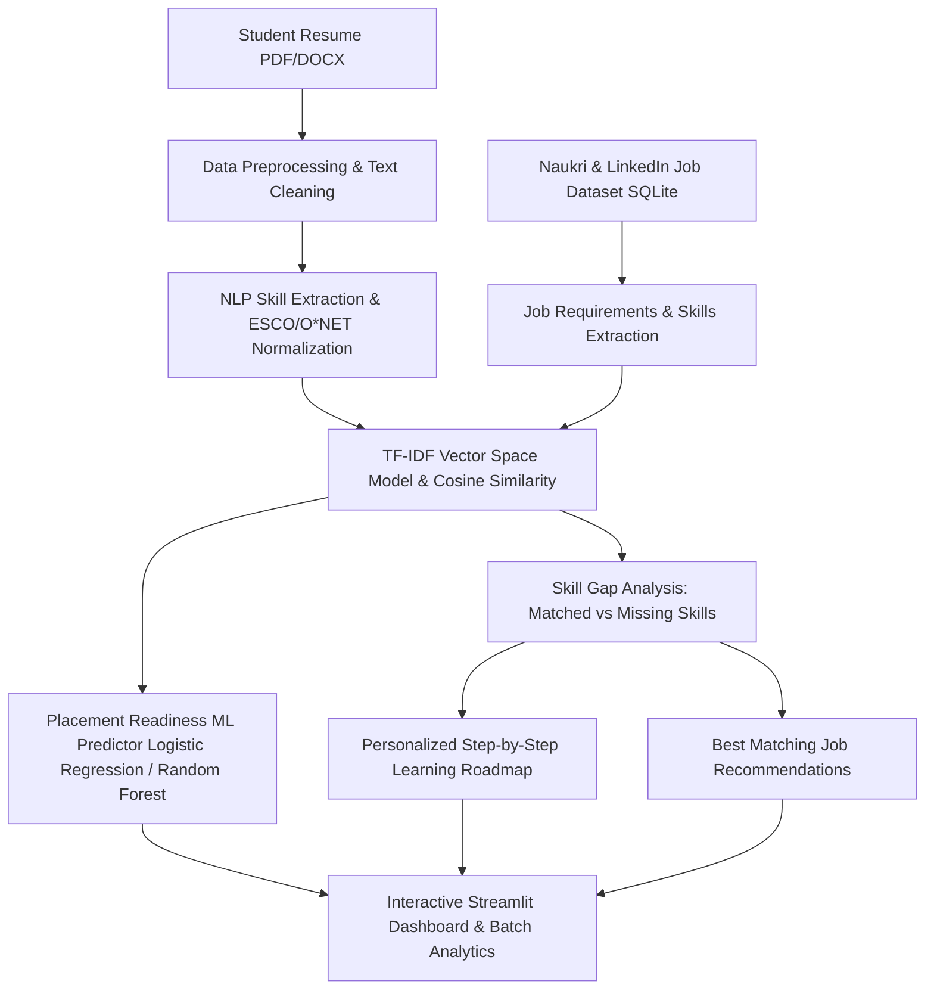

# AI-Powered Placement Readiness & Skill Gap Analyzer

**Department of Computer Science & Engineering (Artificial Intelligence & Machine Learning)**  
**Vidyavardhaka College of Engineering (VVCE), Mysuru**  
*Autonomous Institute, Affiliated to VTU, Belagavi | Approved by AICTE | Accredited by NBA & NAAC 'A' Grade*

---

## 👥 Mini-Project Team Members
- **Sanjana B R** — USN: `4VV25CI414`
- **Namith N** — USN: `4VV25CI409`
- **Rohith S** — USN: `4VV25CI412`

---

## 📖 Project Overview
Campus placements are critical milestones for engineering undergraduates. However, most students prepare without knowing how their current competencies align with actual recruiter requirements. 

**AI-Powered Placement Readiness & Skill Gap Analyzer** is a web application that:
1. Automatically reads and parses student resumes in **PDF**, **DOCX**, or **TXT** formats.
2. Extracts technical skills using NLP and standardizes them using an **ESCO / O\*NET** taxonomy.
3. Compares student profiles against real-world job postings from **Naukri** and **LinkedIn** datasets stored in SQLite.
4. Computes similarity scores using **TF-IDF Term Weighting** and **Cosine Similarity**.
5. Employs trained Machine Learning models (**Logistic Regression**, **Decision Tree**, and **Random Forest**) to predict overall placement readiness.
6. Clearly visualizes **matched skills** and **skill gaps** (missing requirements).
7. Recommends an ordered, personalized **step-by-step learning roadmap** with free resources and mini-project ideas.
8. Provides the **VVCE Placement Cell** with batch-level analytics to detect department-wide skill deficiencies.

---

## 🏗️ System Architecture & Workflow



---

## 🛠️ Technology Stack
- **Backend & Core Logic:** Python 3.12
- **Web Interface:** Streamlit
- **Machine Learning:** Scikit-learn (`LogisticRegression`, `DecisionTreeClassifier`, `RandomForestClassifier`)
- **Natural Language Processing:** NLTK, TF-IDF Vectorizer, RegEx phrase parsing
- **Document Parsing:** `pdfplumber`, `python-docx`
- **Database:** SQLite3 (`database/jobs.db`) & CSV backup
- **Data Visualizations:** Plotly Express, Plotly Graph Objects, Matplotlib

---

## 📁 Repository Directory Structure

```
placement-readiness-analyzer/
├── app.py                           # Main Streamlit web application
├── run.bat                          # Double-click launcher for Windows
├── requirements.txt                 # Project dependencies
├── test_system.py                   # Automated end-to-end verification test suite
├── README.md                        # Project documentation
├── REVIEW_2_PRESENTATION_GUIDE.md    # Mini-Project Review-2 presentation & viva guide
├── database/
│   ├── db_setup.py                  # Database initialization and seeding script
│   ├── jobs.db                      # SQLite database of Naukri & LinkedIn jobs
│   └── jobs_dataset.csv             # CSV backup copy of job listings
├── models/
│   ├── train_readiness_model.py     # ML model training & evaluation pipeline
│   ├── readiness_model.pkl          # Serialized production ML model & scaler
│   └── model_metrics.json           # Accuracy, Precision, Recall, F1, Confusion Matrix
├── modules/
│   ├── resume_parser.py             # PDF, DOCX, and TXT parsing engine
│   ├── nlp_extractor.py             # NLP cleaning and tokenization
│   ├── skill_taxonomy.py            # ESCO / O*NET standardization dictionary
│   ├── matcher.py                   # TF-IDF & Cosine Similarity matching engine
│   ├── roadmap_generator.py         # Step-by-step personalized learning roadmap generator
│   └── batch_analyzer.py            # Batch analytics for VVCE placement cell
└── data/
    ├── sample_resumes/              # Preloaded student profiles for 1-click Review-2 demo
    │   ├── sanjana_ml_resume.txt
    │   ├── namith_data_analyst_resume.txt
    │   └── rohith_software_dev_resume.txt
    └── placement_training_data.csv  # 1200+ sample placement training records
```

---

## 🚀 How to Run the Application

### Method 1: One-Click Windows Launcher
Simply double-click the **`run.bat`** file inside the project directory.

### Method 2: Command Line (PowerShell / Command Prompt)
Navigate to the directory and run:
```bash
streamlit run app.py
```
Then open your browser at `http://localhost:8501`.

---

## 🧪 Running the Automated Verification Tests
To run the automated test suite verifying all 7 modules:
```bash
python test_system.py
```

---

## 🌍 UN Sustainable Development Goals (SDG) Alignment
- **SDG 4: Quality Education** — Identifies student learning deficits and offers targeted self-paced learning paths.
- **SDG 8: Decent Work and Economic Growth** — Empowers engineering graduates to qualify for competitive high-skill tech employment.
- **SDG 9: Industry, Innovation and Infrastructure** — Demonstrates practical deployment of NLP and Machine Learning for academic administration.
